 <div align="center">

# 🚀 Mini-Projet 2 : Application 3-Tiers Sécurisée et Persistante


**Déploiement d'une application de gestion de contacts (CRUD) sécurisée, persistante et conteneurisée sur un cluster Kubernetes K3s.**

</div>

---

## 📖 À propos du projet

Ce mini-projet met en pratique les concepts d'orchestration de conteneurs et d'administration Kubernetes étudiés dans les chapitres 4 à 7 du cours.

L'objectif est de déployer une application 3-tiers composée d'un frontend, d'une API backend et d'une base de données PostgreSQL, tout en assurant la sécurité, la persistance et la disponibilité des données.

Les principales fonctionnalités mises en œuvre sont :

- **Configuration externalisée :** ConfigMap et Secret.
- **Persistance des données :** StatefulSet et PersistentVolumeClaim (PVC).
- **Sauvegardes automatisées :** CronJob.
- **Sécurité réseau :** NetworkPolicies.
- **Contrôle d'accès :** RBAC et principe du moindre privilège.
- **Durcissement des conteneurs :** SecurityContext.
- **Gestion des ressources :** ResourceQuota et LimitRange.
- **Exposition de l'application :** Ingress Traefik.

## 🏗️ Architecture de l'application

L'application repose sur une architecture 3-tiers orchestrée par Kubernetes K3s.

```text
                         UTILISATEUR
                              |
                       Ingress Traefik
                       app.k3s.local
                              |
                       frontend-svc
                              |
                   Deployment Frontend
                         Nginx
                              |
                         api-svc
                              |
                    Deployment API
                     2 réplicas FastAPI
                              |
                         db-service
                       Service Headless
                              |
                    StatefulSet PostgreSQL
                              |
                          PVC data-db-0

                 Sauvegarde de la base de données
                              |
                       CronJob db-backup
                              |
                         PVC backup-pvc
```

### Technologies utilisées

| Technologie | Rôle |
|---|---|
| Docker | Construction et conteneurisation des services |
| Docker Compose | Test local de l'application |
| Kubernetes K3s | Orchestration des conteneurs |
| Python / FastAPI | Développement de l'API backend |
| Nginx | Serveur frontend et accès à l'API |
| PostgreSQL 16 | Stockage des contacts |
| ConfigMap et Secret | Gestion de la configuration |
| StatefulSet et PVC | Persistance des données |
| CronJob | Automatisation des sauvegardes |
| Ingress Traefik | Accès à l'application depuis le navigateur |
| RBAC et NetworkPolicies | Sécurisation du cluster |

---

## 📂 Structure du dépôt

```text
miniproj2/
├── app/
│   ├── backend/
│   ├── frontend/
│   ├── Dockerfile
│   └── docker-compose.yml
├── k8s/
│   ├── 00-namespace/
│   │   └── quota.yaml
│   ├── 10-config/
│   │   ├── app-config.yaml
│   │   └── secret-example.yaml
│   ├── 20-db/
│   │   ├── db-service.yaml
│   │   ├── db-statefulset.yaml
│   │   ├── backup-cronjob.yaml
│   │   └── restore.yaml
│   ├── 30-app/
│   │   ├── api-deployment.yaml
│   │   ├── api-service.yaml
│   │   ├── frontend-deployment.yaml
│   │   ├── frontend-service.yaml
│   │   └── ingress.yaml
│   └── 40-security/
│       ├── rbac.yaml
│       └── network-policies.yaml
├── screenshots/
│   ├── phase1_build_local.png
│   ├── phase1_docker_push.png
│   ├── phase2_quota.png
│   ├── phase3_config_secret.png
│   ├── phase4_statefulset.png
│   ├── phase5_app_deploy.png
│   ├── phase6_ingress_web.png
│   ├── phase7_persistence.png
│   ├── phase8_backup.png
│   ├── phase9_rbac.png
│   ├── phase10_no_token.png
│   ├── phase10_pirate_blocked.png
│   └── phase10_security_context.png
└── README.md
```

*Remarque : adapte les noms des fichiers de cette arborescence à ceux réellement présents dans ton dépôt.*

---

## 🚀 Procédure de déploiement

### Phase 1 — Construction et test local

La première étape consiste à construire les images Docker et à vérifier le fonctionnement de l'application en local avec Docker Compose.

```bash
docker compose up --build -d
```

Vérification des conteneurs :

```bash
docker ps
```

Publication des images sur Docker Hub :

```bash
docker tag miniproj2-api:latest arijbelaid/todo-api:1.0.0
docker tag miniproj2-frontend:latest arijbelaid/todo-frontend:1.0.0

docker push arijbelaid/todo-api:1.0.0
docker push arijbelaid/todo-frontend:1.0.0
```

**Captures d'écran :**

**Construction et test local avec Docker Compose**

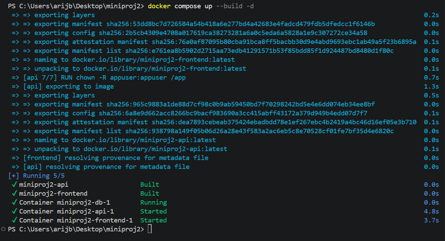

**Publication des images sur Docker Hub**

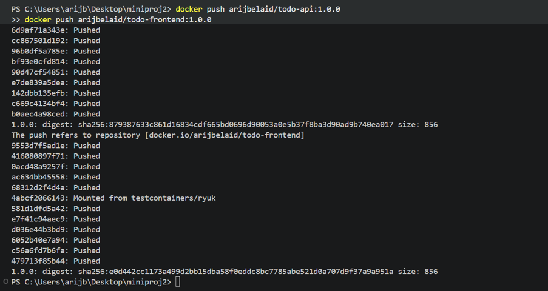

---

### Phase 2 — Création du namespace et gestion des ressources

Cette phase permet d'isoler les ressources du projet et de définir des quotas afin de limiter la consommation des ressources du cluster.

```bash
kubectl apply -f k8s/00-namespace/quota.yaml
```

Vérification du namespace et des quotas :

```bash
kubectl get namespaces
kubectl get resourcequota -n miniproj2
kubectl get limitrange -n miniproj2
```

**Capture d'écran :**

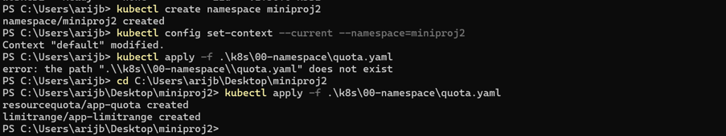

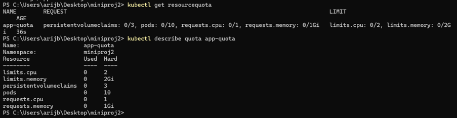


---

### Phase 3 — Configuration avec ConfigMap et Secret

La configuration de l'application est externalisée afin de séparer les paramètres des conteneurs et les informations sensibles.

Création de la ConfigMap :

```bash
kubectl apply -f k8s/10-config/app-config.yaml
```

Création du Secret contenant les identifiants PostgreSQL :

```bash
kubectl create secret generic db-credentials \
  --namespace=miniproj2 \
  --from-literal=DB_USER=appuser \
  --from-literal=DB_PASSWORD='ChangeMe-123'
```

Vérification :

```bash
kubectl get configmap -n miniproj2
kubectl get secrets -n miniproj2
```

**Important :** remplace le mot de passe d'exemple par un mot de passe robuste pour un déploiement réel. Ne publie jamais de véritables identifiants dans GitHub.

**Capture d'écran :**

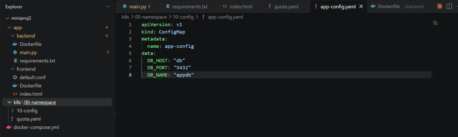
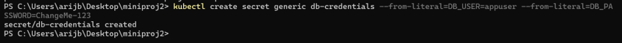


---

### Phase 4 — Déploiement de PostgreSQL avec StatefulSet

La base de données PostgreSQL est déployée avec un StatefulSet et un volume persistant afin de conserver les données même si le Pod est recréé.

Déploiement du service et de la base de données :

```bash
kubectl apply -f k8s/20-db/db-service.yaml
kubectl apply -f k8s/20-db/db-statefulset.yaml
```

Vérification :

```bash
kubectl get statefulset -n miniproj2
kubectl get pods -n miniproj2
kubectl get pvc -n miniproj2
kubectl get services -n miniproj2
```

**Capture d'écran :**

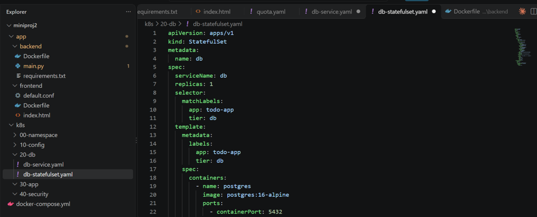
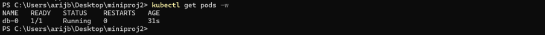


---

### Phase 5 — Déploiement du backend et du frontend

Le backend FastAPI communique avec PostgreSQL pour gérer les opérations CRUD. Le frontend Nginx fournit l'interface web aux utilisateurs.

Déploiement des composants applicatifs :

```bash
kubectl apply -f k8s/30-app/
```

Vérification des Pods et des services :

```bash
kubectl get deployments -n miniproj2
kubectl get pods -n miniproj2
kubectl get services -n miniproj2
```

Consultation des logs de l'API :

```bash
kubectl logs deployment/api -n miniproj2
```

Les noms des ressources doivent correspondre aux noms définis dans les manifestes Kubernetes.

**Capture d'écran :**

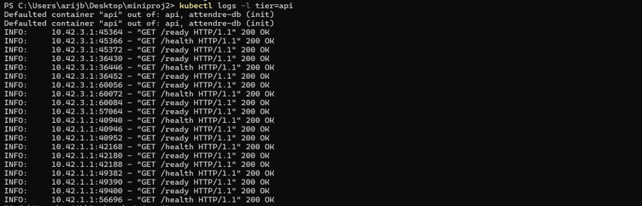

---

### Phase 6 — Exposition de l'application avec Ingress

L'Ingress Traefik permet d'accéder à l'application depuis un navigateur à l'aide du nom d'hôte `app.k3s.local`.

Sous Windows, ouvre le Bloc-notes en tant qu'administrateur et modifie le fichier :

```text
C:\Windows\System32\drivers\etc\hosts
```

Ajoute la ligne suivante, en remplaçant l'adresse IP par celle de la machine qui expose effectivement l'Ingress :

```text
192.168.159.10 app.k3s.local
```

Applique ensuite le manifeste Ingress :

```bash
kubectl apply -f k8s/30-app/ingress.yaml
```

Vérification :

```bash
kubectl get ingress -n miniproj2
kubectl get pods -n kube-system
```

Ouvre ensuite cette adresse dans ton navigateur :

```text
http://app.k3s.local
```

**Capture d'écran :**

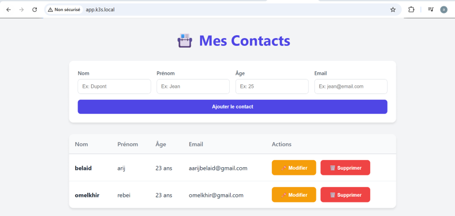

---

### Phase 7 — Vérification de la persistance des données

Cette phase consiste à vérifier que les contacts restent disponibles après la suppression et la recréation du Pod PostgreSQL.

Vérifie d'abord les données présentes dans l'application, puis supprime le Pod :

```bash
kubectl delete pod db-0 -n miniproj2
```

Attends que le StatefulSet recrée le Pod :

```bash
kubectl get pods -n miniproj2 -w
```

Une fois le Pod opérationnel, consulte à nouveau l'application et vérifie que les données sont toujours présentes.

**Capture d'écran :**

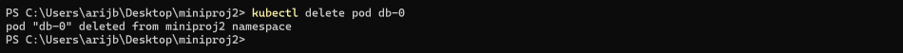

---

### Phase 8 — Automatisation des sauvegardes avec CronJob

Le CronJob `db-backup` automatise la sauvegarde de PostgreSQL. Les sauvegardes sont stockées dans le volume persistant prévu à cet effet.

Déploiement du CronJob :

```bash
kubectl apply -f k8s/20-db/backup-cronjob.yaml
```

Vérification des tâches planifiées :

```bash
kubectl get cronjobs -n miniproj2
kubectl get jobs -n miniproj2
kubectl get pvc -n miniproj2
```

Consultation des logs d'un Pod de sauvegarde :

```bash
kubectl get pods -n miniproj2
kubectl logs <nom-du-pod-de-sauvegarde> -n miniproj2
```

Remplace `<nom-du-pod-de-sauvegarde>` par le nom réel du Pod créé par le CronJob.

**Capture d'écran :**

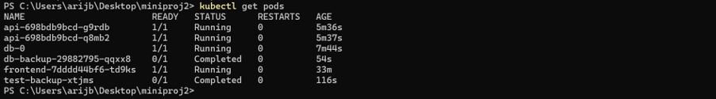

---

### Phase 9 — Sécurisation des accès avec RBAC

Le mécanisme RBAC permet de limiter les permissions des utilisateurs et des comptes de service selon le principe du moindre privilège.

Application des règles de sécurité :

```bash
kubectl apply -f k8s/40-security/
```

Vérification des rôles et des comptes de service :

```bash
kubectl get serviceaccounts -n miniproj2
kubectl get roles -n miniproj2
kubectl get rolebindings -n miniproj2
```

Vérification des permissions :

```bash
kubectl auth can-i get pods \
  --as=system:serviceaccount:miniproj2:app-sa \
  -n miniproj2
```

Adapte `app-sa` au nom réel du compte de service défini dans tes manifestes.

**Capture d'écran :**

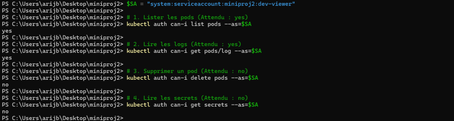

---

### Phase 10 — Durcissement et NetworkPolicies

Cette dernière phase renforce la sécurité des conteneurs et contrôle les communications réseau entre les composants de l'application.

Les mesures appliquées comprennent :

- L'utilisation de `SecurityContext` pour limiter les privilèges des conteneurs.
- La réduction des permissions accordées aux comptes de service.
- La limitation du trafic réseau avec les NetworkPolicies.
- La vérification des accès non autorisés.
- Le contrôle des communications entre le frontend, l'API et la base de données.

Application des manifestes :

```bash
kubectl apply -f k8s/40-security/
```

Vérification des NetworkPolicies :

```bash
kubectl get networkpolicies -n miniproj2
```

Vérification de la configuration de sécurité des Pods :

```bash
kubectl get pods -n miniproj2 -o yaml
```

Les tests doivent confirmer que les communications autorisées fonctionnent et que les connexions non autorisées sont bloquées conformément aux règles définies.

**Capture 1 — Vérification de l'accès sans jeton**


**Capture 2 — Vérification du blocage des connexions non autorisées**

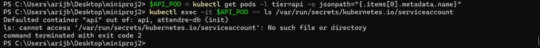

**Capture 3 — Vérification du SecurityContext**

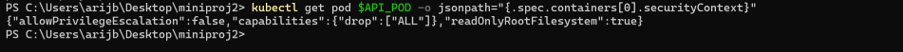

---

## ♻️ Procédure de restauration — Disaster Recovery

La restauration permet de récupérer les données PostgreSQL à partir d'une sauvegarde existante.

### 1. Vérifier les sauvegardes

```bash
kubectl get cronjobs -n miniproj2
kubectl get jobs -n miniproj2
kubectl get pvc -n miniproj2
```

### 2. Lancer la procédure de restauration

Si le manifeste de restauration est configuré pour utiliser le bon PVC et le fichier de sauvegarde attendu, applique-le avec :

```bash
kubectl apply -f k8s/20-db/restore.yaml
```

Vérifie ensuite l'état du Pod ou du Job de restauration :

```bash
kubectl get pods -n miniproj2
kubectl get jobs -n miniproj2
```

Consulte les logs pour vérifier le résultat :

```bash
kubectl logs <nom-du-pod-de-restauration> -n miniproj2
```

**Attention :** le CronJob et le manifeste de restauration doivent être configurés pour utiliser le même volume de sauvegarde et un dump SQL valide. Une sauvegarde n'est considérée comme exploitable qu'après vérification de son contenu et, idéalement, un test réel de restauration.

---

## ✅ Résultats attendus

À la fin du projet, les objectifs suivants doivent être validés :

- [x] Conteneurisation des composants de l'application.
- [x] Organisation de l'application selon une architecture 3-tiers.
- [x] Utilisation de Kubernetes K3s pour l'orchestration.
- [x] Externalisation de la configuration avec ConfigMap et Secret.
- [x] Déploiement de PostgreSQL avec stockage persistant.
- [x] Exposition de l'application via Ingress.
- [x] Mise en place de sauvegardes automatisées.
- [x] Contrôle d'accès avec RBAC.
- [x] Renforcement de la sécurité avec SecurityContext et NetworkPolicies.
- [x] Vérification de la persistance des données.

*Les cases représentent les objectifs du projet ; coche-les uniquement après avoir réalisé et vérifié chaque étape.*

---

## 👨‍💻 Auteur

**Arij Belaid**

Projet réalisé dans le cadre des travaux pratiques Kubernetes et DevOps.

**Dépôt GitHub :** [miniproj2](https://github.com/arijbelaid)

---

<div align="center">

**🚀 Mini-Projet 2 — Kubernetes K3s | Sécurité | Persistance | DevOps**

</div>
