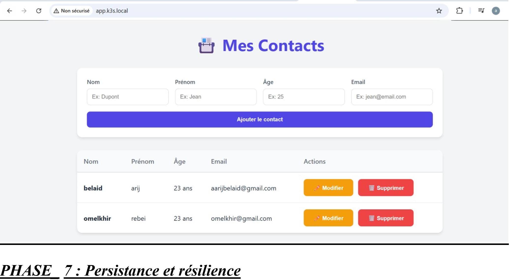
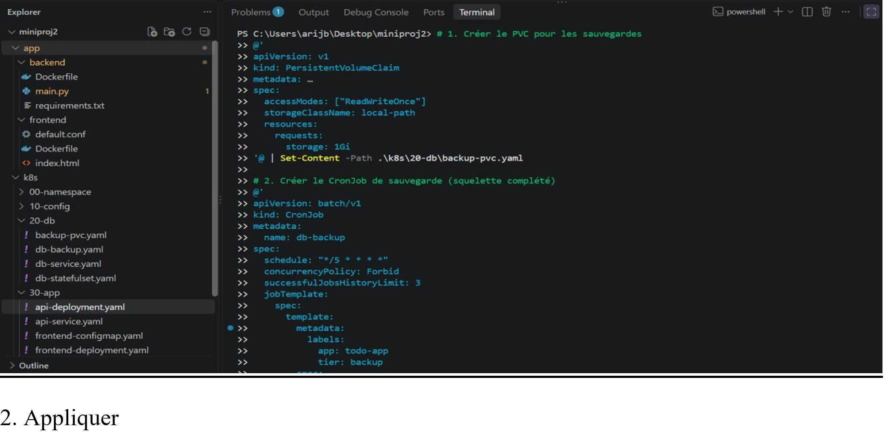
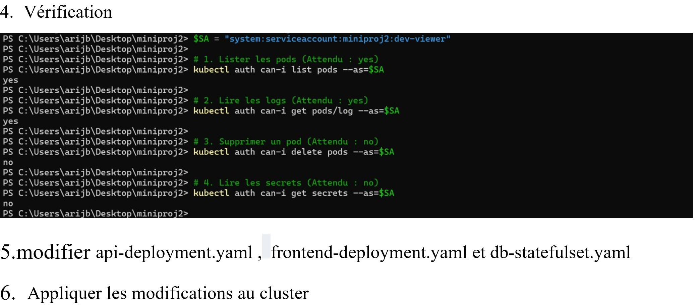

 <div align="center">

# 🚀 Mini-Projet 2 — Application 3-Tiers Sécurisée et Persistante

### Déploiement et sécurisation avec Kubernetes (k3s)


**Cours : Orchestration de conteneurs avec Kubernetes**

**Formation : Master DevOps & Cloud**

**Établissement : ISET Tozeur**

**Réalisé par : Arij Belaid**

**Année universitaire : 2026–2027**

</div>

---

## 1. Présentation du projet

Ce mini-projet consiste à développer, conteneuriser et déployer une application web trois niveaux en utilisant Docker et Kubernetes (k3s).

L'application réalisée est **Mes Contacts**, un gestionnaire de contacts permettant d'ajouter, consulter, modifier et supprimer des contacts.

Le projet met en pratique les principales fonctionnalités de Kubernetes concernant le déploiement, la configuration, la gestion des ressources, la persistance des données et la sécurité.

### Objectifs

- Développer et tester une application en local.
- Construire et publier les images Docker.
- Déployer les composants dans un namespace Kubernetes dédié.
- Configurer ResourceQuota et LimitRange.
- Externaliser la configuration avec ConfigMap et Secret.
- Déployer PostgreSQL avec StatefulSet.
- Assurer la persistance des données avec PVC.
- Exposer l'application avec Ingress et Traefik.
- Mettre en place une sauvegarde planifiée avec CronJob.
- Gérer les permissions avec RBAC et ServiceAccounts.
- Renforcer la sécurité avec SecurityContext et NetworkPolicies.

---

## 2. Architecture de l'application

L'application repose sur une architecture trois niveaux :

| Niveau | Composant | Fonction |
|---|---|---|
| Présentation | Frontend / Nginx | Interface web Mes Contacts |
| Application | API REST | Traitement des opérations CRUD |
| Données | PostgreSQL | Stockage des contacts |

### Architecture Kubernetes

```text
                  UTILISATEUR
                       |
                       |
                Ingress - Traefik
                app.k3s.local
                       |
                       |
                 frontend-svc
                       |
                       |
                FRONTEND POD
                    Nginx
                       |
                    /api/
                       |
                       |
                   api-svc
                       |
                       |
                 API DEPLOYMENT
                   2 REPLICAS
                       |
                       |
                  db-service
                  Headless
                       |
                       |
                POSTGRESQL
                 StatefulSet
                    db-0
                       |
                       |
                    PVC
                 Persistent
                   Storage


              BACKUP : CronJob
                       |
                    pg_dump
                       |
                    backup-pvc


              SÉCURITÉ KUBERNETES
                       |
              +--------+--------+
              |        |        |
           Resource  LimitRange  RBAC
            Quota
                       |
                 NetworkPolicies
                       |
                 SecurityContext
```

### Technologies utilisées

- Docker et Docker Compose.
- Docker Hub.
- Kubernetes (k3s).
- PostgreSQL.
- Python pour le backend.
- HTML, CSS et JavaScript pour le frontend.
- Nginx.
- Traefik et Ingress.
- YAML.
- PowerShell.
- VMware Workstation.

---

## 3. Organisation du dépôt

```text
Mini-Projet2-Kubernetes/
│
├── app/
│   ├── backend/
│   │   ├── Dockerfile
│   │   ├── main.py
│   │   └── requirements.txt
│   │
│   └── frontend/
│       ├── Dockerfile
│       ├── default.conf
│       └── index.html
│
├── k8s/
│   ├── 00-namespace/
│   │   └── quota.yaml
│   │
│   ├── 10-config/
│   │   ├── app-config.yaml
│   │   └── secret.example.yaml
│   │
│   ├── 20-db/
│   │   ├── db-service.yaml
│   │   ├── db-statefulset.yaml
│   │   ├── backup-pvc.yaml
│   │   └── db-backup.yaml
│   │
│   ├── 30-app/
│   │   ├── api-deployment.yaml
│   │   ├── api-service.yaml
│   │   ├── frontend-configmap.yaml
│   │   ├── frontend-deployment.yaml
│   │   ├── frontend-service.yaml
│   │   └── ingress.yaml
│   │
│   └── 40-security/
│       ├── serviceaccounts.yaml
│       └── rbac.yaml
│
├── screenshots/
│   ├── 01-docker-compose-build.png
│   ├── 02-application-local-mes-contacts.png
│   ├── 03-docker-image-tagging.png
│   ├── ...
│   └── 43-final-application-validation.png
│
├── docker-compose.yml
├── .gitignore
└── README.md
```

---

## 4. Réalisation du projet par phases

### Phase 0 — Développement et test local

Construction des composants avec Docker Compose et vérification du fonctionnement de l'application Mes Contacts.

**Preuves :**


### Phase 1 — Conteneurisation et publication

Création des images Docker, attribution des tags versionnés et publication sur Docker Hub.

Images applicatives :

- `arijbelaid/todo-api:1.0.0`
- `arijbelaid/todo-frontend:1.0.0`

**Preuves :**


### Phase 2 — Namespace, ResourceQuota et LimitRange

Création du namespace `miniproj2`, configuration des quotas et définition des limites de ressources.

**Preuves :**


### Phase 3 — ConfigMap et Secret

Externalisation de la configuration et création des identifiants de connexion à la base de données avec Kubernetes Secret.

Un fichier modèle est utilisé pour Git afin de ne pas publier les véritables identifiants.

**Preuves :**


### Phase 4 — Base de données avec StatefulSet

Déploiement de PostgreSQL avec un Service Headless et un StatefulSet.

Configuration du volume persistant pour conserver les données de la base.

**Preuves :**


### Phase 5 — Déploiement API et frontend

Déploiement des composants applicatifs dans Kubernetes et vérification de leur état.

Consultation des logs de l'API pour vérifier les requêtes `/health` et `/ready`.

**Preuves :**


### Phase 6 — Ingress

Configuration de Traefik et création de l'Ingress pour permettre l'accès à l'application à travers le nom d'hôte `app.k3s.local`.

**Preuves :**




### Phase 7 — Persistance et résilience

Ajout de contacts et vérification de leur présence dans PostgreSQL.

Suppression du Pod `db-0`, puis vérification de sa recréation automatique et de la conservation des données.

Test de la résilience des Pods API.

**Preuves :**


### Phase 8 — Sauvegarde planifiée

Création du volume de sauvegarde et configuration du CronJob pour automatiser les sauvegardes PostgreSQL.

Exécution d'un Job de test et vérification de l'état des Pods ainsi que des données de la base.

**Preuves présentes dans le rapport :**




### Phase 9 — RBAC et ServiceAccounts

Création des ServiceAccounts et configuration des permissions avec Role et RoleBinding.

Vérification des droits d'accès du compte `dev-viewer` et modification des manifestes applicatifs.

**Preuves :**





### Phase 10 — Durcissement et NetworkPolicies

Application des configurations de sécurité et vérification de la désactivation du montage automatique du jeton ServiceAccount.

Test des NetworkPolicies et vérification du SecurityContext avec les paramètres de sécurité des conteneurs.

Validation du fonctionnement final de l'application.

**Preuves :**


---

## 5. Vérification générale

Commandes utilisées pour contrôler les ressources Kubernetes :

```powershell
kubectl get nodes

kubectl get namespaces

kubectl get pods -n miniproj2

kubectl get services -n miniproj2

kubectl get deployments -n miniproj2

kubectl get statefulsets -n miniproj2

kubectl get pvc -n miniproj2

kubectl get ingress -n miniproj2

kubectl get networkpolicies -n miniproj2
```

---

## 6. Correspondance avec les exigences du sujet

| Exigence | Description | Phase |
|---|---|---|
| E1 | Images Docker versionnées et publiées | 1 |
| E2 | Namespace, ResourceQuota et LimitRange | 2 |
| E3 | ConfigMap et Secret | 3 |
| E4 | Protection des Secrets dans Git | 3 |
| E5 | StatefulSet et Service Headless | 4 |
| E6 | Persistance des données | 7 |
| E7 | Démarrage et disponibilité de l'API | 5 |
| E8 | Gestion des ressources | 2 et 5 |
| E9 | Readiness et Liveness Probes | 5 |
| E10 | Exposition avec Ingress | 6 |
| E11 | Sauvegarde planifiée | 8 |
| E12 | RBAC et ServiceAccounts | 9 |
| E13 | Durcissement des Pods | 10 |
| E14 | NetworkPolicies | 10 |
| E15 | Organisation du dépôt Git | Ensemble du projet |

---

## 7. Conclusion

Ce mini-projet nous a permis de mettre en pratique les concepts essentiels de Kubernetes et des pratiques DevOps à travers le déploiement d'une application trois niveaux.

La réalisation a permis de travailler sur la conteneurisation, l'orchestration, la gestion des ressources, la configuration externalisée, la persistance des données et la sécurisation des communications.

Les différentes phases ont également permis de comprendre les mécanismes de résilience, de contrôle des accès et de protection des applications dans un environnement Kubernetes.

**Mini-Projet 2 — Application 3-Tiers Sécurisée et Persistante**

**Master DevOps & Cloud — ISET Tozeur**

**Année universitaire 2026–2027**

